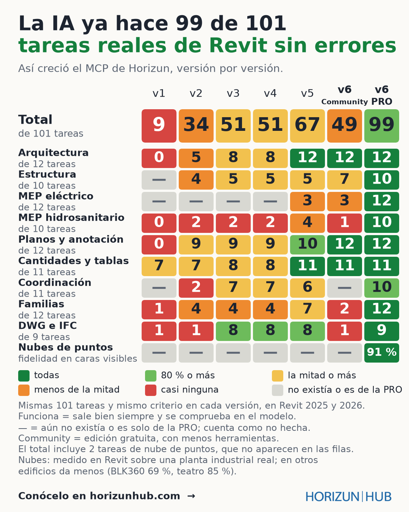

# Horizun Revit MCP Community 6.0 — model, document and deliver in Revit

**Made in Colombia 🇨🇴 by Horizun Group.**

Horizun Revit MCP Community is a free, open-source (Apache-2.0) Windows MCP
server and Revit add-in for **Autodesk Revit 2023–2027**. Its catalog contains
**110 tools** <!--inventory:tools--> with **573 named suboperations and dispatch modes** <!--inventory:operations-->
for architectural and structural modeling, drawings and sheets, model audits,
quantities, Excel, Power BI and exports. MEP modeling, DWG to BIM,
reinforcement, IFC to BIM and IFC delivery, point clouds, family authoring and
coordination are in the Pro edition: see [Community vs Pro](#community-vs-pro).

Use natural-language objectives in your MCP client to create new BIM content,
inspect existing models and carry out multi-step production workflows. Typed
changes include rehearsal, explicit targets and post-commit verification;
owner-enabled Python extends the bridge to task-specific Revit API automation.
The downloadable Windows installer includes the server runtime and Revit add-ins.

**English** · **[Español](README.es.md)**

[](https://github.com/HorizunGroup/horizun-revit-mcp/actions/workflows/ci.yml) [](https://github.com/HorizunGroup/horizun-revit-mcp/actions/workflows/codeql.yml) [](https://github.com/HorizunGroup/horizun-revit-mcp/releases/latest) [](#install) [](https://registry.modelcontextprotocol.io/) [](LICENSE) [](https://github.com/HorizunGroup/horizun-revit-mcp/stargazers)

**[Download](https://github.com/HorizunGroup/horizun-revit-mcp/releases/latest)** ·
**[Watch the demo](https://www.youtube.com/watch?v=tlFs5p3EM4M)** ·
[What's new in 6.0 Community](#whats-new-in-60-community) ·
[Community vs Pro](#community-vs-pro) ·
[Install with Claude Desktop Free](#installation-video-claude-desktop-free) ·
[All tools](#complete-tool-catalog) · [Suboperations](#suboperations-and-modes) ·
[Release evidence](#tested-in-revit-published-release-evidence) · [Install](#install)

## What's new in 6.0 Community

The first Community release since 4.0.1. The detail is in the [CHANGELOG](CHANGELOG.md).

- **Revit in Spanish:** on a Spanish-language Revit, the English names of common parameters and categories resolve, and every row that names a category carries `built_in_category`. Reference planes, self-closing dialogs, `set_curve` retries, curtain-wall doors and volumes no longer depend on the language.
- **Safer typed writes:** a bare number in a length parameter is read as feet, so `horizun_write_params_verified` and `horizun_create_elements` refuse one that is not a building measure; `accept_raw_feet=true` accepts it and the reply says how it was read (`number_read_as`). `horizun_execute_python` refuses after a typed write that failed midway, until the model is re-read or undone.
- **Identity guard:** typed writers that take existing-element ids accept `identity` / `unique_id` and refuse the whole call, writing nothing, when the element is not the one rehearsed. On a deletion, in a collaborative model or on an element that is not this user's, category or type alone is not enough. See [docs/IDENTITY-GUARD.md](docs/IDENTITY-GUARD.md).
- **Sheets inside the title block frame:** `horizun_sheet_layout` `auto_layout` without `margins` lays out viewports inside the drawing frame read from the title block family's lines, and leaves a corner title box free. `get_viewport_box` reports `drawing_area_check`; `repair_outside=true` moves only the viewports that fall outside, and a repair that creates an overlap is refused and rolled back.
- **Tool groups and profiles:** every tool belongs to one group; a profile (`--profile`, `HORIZUN_PROFILE` or `tool_profile`) decides what is LISTED, never what may run, and `horizun_toolsets` activates groups for the session. See [docs/TOOL-GROUPS.md](docs/TOOL-GROUPS.md).
- **Annotation, views and delivery:** tags that look for a free spot and refuse the batch when none is found, note leaders verified against their target, rehearsed polygonal view crops, `horizun_selection_context` `operation=view_contents`, `horizun_manage_worksets` `operation=loans`, export folders created on apply (`require_existing_folder` to require them) and `horizun_export` `pdf_qa`.
- **Collaborative models:** `horizun_save_document` `operation=sync_with_central` rehearses and applies with its `confirmation_token`, and is refused while a write of the session has a failed or unmeasured check.

## 101 real client tasks

The same 101 client tasks and the same criterion in every version, measured in Revit 2025 and 2026. Pro 6.0.1 completes 99 of 101; the free Community 6.0.0, with fewer tools, completes 49. Point cloud to model: 91 % fidelity on visible faces (Pro), measured in Revit on a real industrial plant. The chart is in Spanish.



## Community vs Pro

| Capability area | Community (this repository) | Pro |
|---|---|---|
| Connection, health, targets, jobs, tool groups | Yes | Yes |
| Model queries, model scan, audits and verified corrections | Yes | Yes |
| Architectural and structural modeling (walls, floors, roofs, stairs, beams, columns, foundations, framing, curtain walls, terrain) | Yes | Yes |
| Parameters, materials, phases, worksets, groups, assemblies | Yes | Yes |
| Drawings, views, sheets, schedules, dimensions, tags, 2D details | Yes | Yes |
| Quantities, budget comparison, Excel, Power BI | Yes | Yes |
| Export (PDF, DWG, IFC, NWC, FBX, images, schedule CSV) and PDF QA | Yes | Yes |
| ISO 19650 project context and information containers | Yes | Yes |
| Composable plans, workflow procedures and prompts, owner-enabled Python | Yes | Yes |
| MEP modeling and connection (routing, fittings, systems, fixtures, electrical, connectivity audit) | — | Yes |
| DWG / CAD to BIM and DWG revision updates | — | Yes |
| Structural reinforcement (plan, apply, audit) | — | Yes |
| IFC to BIM and verified IFC delivery (`horizun_deliver_ifc`) | — | Yes |
| Point clouds to model | — | Yes |
| Family authoring and editing (create, reload, apply, internals) | — | Yes |
| Coordination: RVT links, clash detection and resolution, coordination views, federation check, copy between documents | — | Yes |

The 41 Pro tools are not in this repository: their code and documentation were
removed from the tree, and the Community contract does not announce them.

## Small local models (Ollama / qwen3:8b)

Set `HORIZUN_SCHEMA_MODE=local` (or `HORIZUN_PROFILE=local`) in the **MCP server
process**, and use `qwen3:8b` with Ollama chat `options.num_ctx=16384` in your agent.
The local surface advertises up to 11 essential tools, including search/describe/call,
with common arguments and descriptions of at most 200 characters. Permission profiles
and enabled toolsets still apply; `safe_write` currently exposes 10 of these tools.
Advanced arguments and other tools remain available through `horizun_describe_tool`
and `horizun_call_tool`. Search tasks in either language, e.g. `query="count walls"`
or `query="contar muros"` in `horizun_list_tools`.

Search returns the best three relevant matches, including partial Spanish/English tasks
such as `create_sheet`, `place_view`, `tag de puertas visibles` and `planta`.
Before using a view or level ID, call `get_document_info` with
`{"operation":"context","max_rows":100}`. It lists levels (ID, name, elevation in metres)
and non-template views (ID, name, type, associated level); follow `next_offset` until null.
Missing view/level lookups in capture, navigation and creation return nearby valid names
and IDs without substituting them. Permission and toolset filters still apply.

Local mode automatically compacts successful read replies: short text plus the data
once in `structuredContent`, without verbose queue/safety payloads. Coverage, paging,
sanitization and safety findings remain; writes and errors retain their verification
and diagnostics. Use `max_rows=1` for `horizun_list_elements` counts, or
`response_mode="summary"` for `horizun_query_model`. Rows are never silently dropped.
`HORIZUN_RESPONSE=compact` also works in other schema modes; `full` opts out.

Measured over isolated stdio: **local 2,753 estimated tokens** with `safe_write`,
2,948 with all 11 tools (`ceil(UTF-16 characters/4)`). The complete 11-tool JSON
also measured **2,647 Qwen3:8b tokens** through Ollama raw prompt evaluation;
this excludes the agent's conversation and tool-template overhead.
See [configuration and live-test instructions](docs/CLIENTS.md#ollama--qwen-small-local-models).
Revit/Ollama live performance has not been re-tested for this change.

## Earlier: what came in 3.0

- **Schedules from drawings:** `horizun_read_schedule` reads vector PDF or DWG schedule cards and refuses ambiguous rows. The 3.0 reinforcement rules are in the Pro edition.
- **Interoperability:** `horizun_exchange` emits and verifies `horizun.exchange/0` manifests, carries model identity, and checks review correction plans before and after applying them. See [tool details](docs/TOOLS-EXTENDED.md).
- **Schema on demand:** `full` remains the default. Set `HORIZUN_SCHEMA_MODE=facade` per client to expose health and three server-side discovery/call tools, which retrieve exact schemas as needed. The measured reduction in `tools/list` size has not yet been paired with a completed agent comparison. See [client setup](docs/CLIENTS.md) and [measurements](docs/plans/lazy-schema-3.0.md).
- **Local toolset:** `HORIZUN_TOOLSETS=local` narrows the advertised typed surface for short-context clients while preserving the permission gate. The schema mode and toolset are independent.

For existing installations, follow [Migration to 3.0](docs/MIGRATION-3.0.md): protocol 3 requires the server and add-in to be updated together. [Release notes](docs/plans/release-notes-3.0.0.md) summarize the release.

## Product at a glance

| Surface | What is available | Inspect it |
|---|---|---|
| MCP entry points | **110 tools** <!--inventory:tools-->, including **38 read-only** <!--inventory:reads--> and **72 with possible effects** <!--inventory:writes--> | [Generated inventory](docs/inventory.json) and full catalog below |
| Internal actions | **573 named suboperations and dispatch modes** <!--inventory:operations--> inside multi-operation tools | Exact selector values below |
| Revit coverage | 2023, 2024, 2025, 2026 and 2027 | Five matching add-ins and versioned live reports |
| New model content | 26 element kinds; structural planning | [Architecture creation](docs/ARCHITECTURE-CREATION.md) |
| Drawings and deliverables | 24 view/sheet actions, 10 annotation actions, native schedules and sheet layout | [Planimetry production](docs/PLANIMETRY-PRODUCTION.md) |
| Export targets | PDF, DWG, DGN, DWFx, IFC, NWC, FBX, gbXML, COBie, RFA families, images and schedule CSV | `horizun_export` |
| Verified release example | 1,230 passed probe executions across five Revit years in **v1.3.3** | [Published reports](#tested-in-revit-published-release-evidence) |
| Installation | Windows Setup with runtime included; no Git, Visual Studio or .NET SDK for end users | [Client-specific final steps](docs/CLIENTS.md) |

Counts describe the complete Community surface. The active permission profile and
tool packs determine which tools a particular session exposes; the measured
70/79/80-tool profiles are explained below.

## What came in 2.1

Every item below was built with the same verified-write contract
(rehearse, token, apply, re-read) and, where a fixture exists, was measured live in Revit.
The detail of each one is in the [CHANGELOG](CHANGELOG.md). The 2.1 items in Pro
areas (MEP routing and slopes, clash openings and sleeves, MEP system analysis,
Navisworks round trip, BCF, shared coordinates, point clouds and scan deviation)
are in the Pro edition.

**New tools and new ways to build**

1. **Light-gauge framing, `horizun_framing`** — studs, tracks, kings, jacks, headers, sills, cripples and blocking inside a wall layer, and suspended-ceiling framing, from a detail spec the MCP client reads from an image or DWG (prompt `framing-from-detail`).
2. **Curtain-method framing** — the same framing modeled with Curtain Walls and flat Sloped Glazing layers (stud mullions, fixed-distance grids, hangers to the floor above), for teams that work that way.
3. **Exploding multilayer walls with openings** — `horizun_split_multilayer_walls` now converts walls that host doors, windows and nested components: the carrier keeps its identity and its inserts, and every layer becomes its own wall.
4. **COBie 2.4 workbook** — `horizun_export format=cobie`: Facility, Floor, Space, Zone, Type, Component and System sheets, re-read cell by cell, with `deliverable_ready` and a finding for every missing required value.
5. **New element kinds** — sprinkler, flex pipe, flex duct, space, area and area boundary in `horizun_create_elements`; rooms and spaces for every empty circuit (`placement=all_enclosed`); toposolids (Revit 2024+).
6. **Sketch editing without losing the element** — `edit_sketch` for floors, ceilings and openings keeps the id and the hosted data.

**CDE and information management**

7. **ACC Issues** — `horizun_cde_cloud issues_list / issue_create / issue_update`, as the signed-in user, idempotent by an external key and read back after every write.
8. **ISO 19650 information management** — project context (`project-intake`) and information containers across WIP/Shared/Published/Archived. IFC delivery proved against IDS is in the Pro edition.
9. **Synchronize with central** — `horizun_document_session sync_with_central`, off by default and enabled only by the machine owner in Revit; relinquish all, keep borrowed or none, verified after the sync.

**Verification you can see**

10. **Spatial check after every write** — overlaps, blocked doors, duplicates and MEP through structure are reported with the write; `horizun_verify_changes` returns an image with the changed elements highlighted.
11. **Before/after snapshots** — `snapshot / compare_to` with the same camera and a red diff mapped back to the elements written.
12. **Equipment clearance zones** — `clearance_rules` check working-space zones against host and links.
13. **Egress travel distance** — `horizun_code_check` with Revit's path of travel, reported as a lower bound or `not_decidable` with the reason.
14. **Energy readiness** — `energy_readiness` builds and rolls back the energy model and reports enclosure, constructions and window-to-wall ratio.

**Documentation, quantities and exchange**

15. **More export formats** — DWG for many views or sheets in one job, gbXML, DGN, DWFx and loaded families to `.rfa`, each file read back.
16. **Finishes by room** — `horizun_quantities room_finishes`: wall, floor and ceiling faces per room or space, by material, with openings deducted.
17. **Budget export to BC3** — `horizun_budget_compare export_bc3` (FIEBDC-3) from the takeoff and the caller's prices.
18. **Sheets and views** — `renumber_sheets` with collisions checked first, and `set_view_display` fixes detail level or discipline citing the audit finding.
19. **Structural analytical model and loads** — `horizun_query_structure analytical` and `loads`, grouped by load case.
20. **A smaller tool list** — `tools/list` is about 64 KB smaller without removing a tool, argument or operation, so clients load it faster.

## Watch a real workflow: PDF plans to a Revit model

[](https://www.youtube.com/watch?v=tlFs5p3EM4M)

**[PDF plans → Revit model with AI — watch on YouTube](https://www.youtube.com/watch?v=tlFs5p3EM4M)**
is a published Spanish-language demonstration from the Horizun Hub channel.
It presents a PDF-to-Revit workflow driven by an AI client. PDF interpretation
belongs to the client/model; Horizun supplies the operations executed in Revit.
The typed DWG-to-BIM workflow, which reads CAD geometry and versioned rules, is
in the Pro edition.

## What you can build and deliver

### Architectural and structural modeling

`horizun_create_elements` accepts dependency-aware batches of levels, grids,
walls, floors, ceilings, roofs, rooms, family instances, structural beams and
columns, beam systems, wall foundations, ducts, pipes, conduit, cable trays,
fittings, inline accessories, MEP systems, openings, shafts, room separators,
profile walls, displacement sets and supported stairs.

The suboperation table lists all 26 creation kinds and five fitting choices.
`horizun_transform_elements` handles moves, copies, rotations, wall joins,
type/curve changes and tag placement. The structural planner produces requests
that use these same creation tools. MEP routing, fittings, connections, system
types and the MEP planner are in the Pro edition.

### Drawings, automated annotation and sheet production

Build floor/ceiling/structural/area plans, sections, elevations, callouts, drafting
and 3D views. Manage templates, phases, crops, view ranges and scope boxes; create,
duplicate and populate sheets; place schedules and align viewports. Annotation
tools support text, tags, linear/angular/radial/diameter/arc-length dimensions
and spot elevation/coordinate/slope labels.

Plan dimensions and tags from explicit criteria, inspect geometric references,
create 2D details, audit planimetry, apply cited corrections and pack sheet zones.
`horizun_plan_views` and the `deliverable-production` prompt coordinate delivery
stages and approval state. [Drawing workflows](docs/PLANIMETRY-PRODUCTION.md).

### Audits, quantities and data exchange

Query the host and loaded links using category, family/type, level, parameter and
spatial filters. Scan model health, audit supplied requirements and make verified
parameter corrections.

Produce material takeoffs, compare them against an Excel budget baseline, read
or append XLSX rows without Excel/COM, push approved data to Power BI and export
verified deliverables. [Quantities](docs/QUANTITIES-AND-BUDGET.md),
[Power BI](docs/POWER-BI.md), [audit starter](docs/QUICK-START-BIM.md).

### Specialized model transformations and terrain

Separate wall or slab layers, split floors by loops, rectangularize supported
wall geometry, ungroup with origin tracking and regroup by a parameter. Transfer
slab elevations, embed floors in toposolids and grade terrain with breaklines and
specified slopes. Wall-layer decomposition preserves the core wall's identity
and hosted elements. Bundled recipe tools use shipped Python for geometry under
host-controlled rehearsal, transactions and their declared readback checks;
arbitrary client-generated Python has a separate permission/evidence contract.

### In the Pro edition

New parametric families with MEP connectors, DWG to BIM with traceable revision
updates, MEP modeling, coordination and clash resolution, reinforcement, IFC to
BIM and IFC delivery, and point clouds are in Horizun Revit MCP Pro
([Community vs Pro](#community-vs-pro)).

## Install

**[Download the Windows installer](https://github.com/HorizunGroup/horizun-revit-mcp/releases/latest)**

- Requires **Windows x64, Revit 2023–2027 and an MCP client**.
- Setup includes the server runtime and matching Revit add-ins.
  **No Git, Visual Studio or .NET SDK is needed.**
- Close Revit before running Setup.
- Public releases are intentionally **unsigned**. SHA-256 checks verify the
  downloaded bytes; they do not authenticate a Windows publisher. Windows and
  Revit may show a publisher warning. See the [unsigned release policy](CODE-SIGNING-POLICY.md).

1. Open the release above and download `horizun-mcp-<version>-setup.exe` and
   `SHA256SUMS.txt` from **Assets**. The source ZIP is for development.
2. Verify the hash using the [installation guide](docs/INSTALL.md), then run Setup.
3. Complete your client's connection step:

| Client | Final connection step |
|---|---|
| **Codex / Claude Code** | Let Setup's helper register after the client closes, then reopen it. |
| **Claude Desktop** | Install the `.mcpb` delivered to **Documents\Horizun-Revit-MCP** from **Settings → Extensions**, then restart Claude Desktop. |
| **ChatGPT Work** | Complete the Secure MCP Tunnel setup for the installed server. |
| **Other stdio clients** | Register the installed executable using its full path. |

4. Start Revit, open a document and ask your client to call `horizun_health`.
   Confirm the active document and loaded version.

**Claude Desktop needs the extension installation inside the app.** Setup puts
the package and illustrated instructions in the Documents folder above. Drag
the package onto the Extensions page or use **Advanced settings → Install extension**.
The extension connects to the installed server; it does not replace Setup.
See [client instructions and recovery](docs/CLIENTS.md).

### Installation video: Claude Desktop Free

[](https://www.youtube.com/watch?v=3kp-we7MIvk)

**[Connect Revit to Claude Desktop Free — watch the installation tutorial](https://www.youtube.com/watch?v=3kp-we7MIvk)**
is a Spanish-language guide published by Horizun Hub to installing and connecting
Horizun Revit MCP with the free Claude Desktop plan. Follow the Setup and `.mcpb`
steps above; the [client guide](docs/CLIENTS.md#claude-desktop) provides the written instructions.

### Optional PowerShell bootstrap

This downloads the release installer, checks its hash and runs Setup quietly.
`-AllowUnsigned` acknowledges the publisher status described above. The same
client-specific final steps still apply; use `-Interactive` for the wizard.

```powershell
$s = irm https://raw.githubusercontent.com/HorizunGroup/horizun-revit-mcp/main/install-release.ps1; & ([scriptblock]::Create($s)) -AllowUnsigned
```

The script is fetched from `main`; its checksum check applies to the downloaded
Setup. You can download and inspect the script first. See [installation options](docs/INSTALL.md).

## Complete tool catalog

Every named MCP tool of the Community edition is listed here, grouped by the work it performs. These groups
are a reading aid; session **tool packs** are the configurable sets implemented
in [ToolPacks.cs](src/Horizun.Revit/Core/ToolPacks.cs). Descriptions are maintained
in [the bilingual catalog](docs/readme-catalog.json); counts and membership are
checked against the server-generated [inventory](docs/inventory.json).
The [detailed tool reference](docs/TOOLS.md) documents arguments and limitations.

<!-- BEGIN TOOL CATALOG -->
### Connection, documents and background jobs

| Tool | Capability |
|---|---|
| `get_document_info` | Inspect the open document's identity and element counts. |
| `horizun_document_session` | Inspect, open, save, save-as and close documents, or create a blank project from a template, through explicit session operations. |
| `horizun_file_info` | Read RVT/RFA headers, version and worksharing metadata without opening or upgrading them. |
| `horizun_health` | Report bridge health, active document, version, commit and Python runtime state. |
| `horizun_job_status` | Read progress and recovery state while Revit is busy or after a process restart. |
| `horizun_open_document` | Open a model with checks for version upgrades and workshared central files. |
| `horizun_relinquish_all` | Release owned worksharing elements and report remaining ownership. |
| `horizun_repair_memory` | Report and recover durable state this bridge keeps when a record is unreadable. |
| `horizun_save_document` | Save and inspect the resulting file's timestamp and size. |
| `horizun_selection_exchange` | Read what a person selected in Revit, and offer a set back for them to select. |
| `horizun_submit_job` | Submit long-running Revit operations with a persistent job identifier. |
| `horizun_target` | Select the Revit instance to control when multiple sessions or years are open. |

### Model queries, audits and correction

| Tool | Capability |
|---|---|
| `horizun_apply_corrections` | Rehearse and apply supported audit corrections with per-result verification. |
| `horizun_selection_context` | Read the context of the selection or of given ids, snapshot and diff it, and revalidate ids after a synchronize. |
| `horizun_audit_access` | Report what this bridge is allowed to do on this machine and who decided it. |
| `horizun_audit_model` | Evaluate supplied model requirements with findings, coverage and prevention-gate evidence. |
| `horizun_capture_view` | Export the active or named view as an image for visual review by the client. |
| `horizun_verify_changes` | Check what the last write changed for spatial conflicts and return an image with them highlighted. |
| `horizun_delete_verified` | Delete explicit IDs or purge unused content; preview cascades and verify removals. |
| `horizun_list_elements` | List and paginate elements across the host and loaded Revit links with model identity. |
| `horizun_model_scan` | Measure model health, warnings, worksets, links, families, views and cleanup candidates. |
| `horizun_navigate` | Select elements, clear selection, zoom and open views. |
| `horizun_query_model` | Filter by category, type, level, parameters and spatial bounds; project fields and return grouped or compact summaries. |
| `horizun_validate_ids` | Check a model against an IDS specification and report each requirement it fails. |
| `horizun_query_classification` | Read the keynote and assembly-code tables, their use in the model, missing and unused codes, and families' lookup tables. |
| `horizun_model_diff` | Snapshot models and compare deliveries: added, deleted and changed elements with parameters, a coloured view, a plain summary and quality history. |
| `horizun_code_check` | Check the model against declarative requirement sets, including Colombian accessibility, egress and lighting rules, with not_decidable instead of guesses. |
| `horizun_undo` | List and undo the last verified Horizun batch, refusing when the model or file changed since. |
| `horizun_measure_geometry` | Measure solid volume, section profile, bounding box, end points and face normals of ids or a selector; unreadable elements are named, never zero. |
| `horizun_query_relations` | Read what elements are joined to, cut by, cutting, hosted by, hosting and near, with category and relation type. |
| `horizun_audit_support` | Find floating elements, beam ends on nothing, rooms without a floor under them and a model shifted against its link (read-only). |

### Model creation, parameters and families

| Tool | Capability |
|---|---|
| `horizun_bind_shared_param` | Bind shared parameters to categories and inspect group-variation behavior. |
| `horizun_create_elements` | Create levels, grids, walls, slabs, roofs, rooms, family instances, structural members, MEP runs, openings and stairs in typed batches. |
| `horizun_template_kit` | Load, inspect and audit project templates through a reusable template kit. |
| `horizun_manage_materials` | Read, create and assign materials and their appearance and identity data. |
| `horizun_manage_classification_table` | Read and manage classification tables used by model types and families. |
| `horizun_set_keynote` | Assign keynote values with the affected instance/type scope made explicit. |
| `horizun_wall_sweep` | Create and verify wall sweeps and reveals on explicit walls. |
| `horizun_join_geometry` | Join, unjoin and switch who cuts between walls, floors, framing, columns and foundations by a stated priority; the shared volume is re-read to zero. Finds and closes open L/T wall corners; auto_priority joins a whole level. |
| `horizun_room_finishes` | Create finish floors and baseboards by room: contour from the room's finish faces, floor type by its use, re-read area and no overlap with walls. |
| `horizun_wall_finish` | Match ARQ walls to the EST cores of a link and place finish walls on the core faces with no shared volume. |
| `horizun_transform_elements` | Move, copy, rotate, pin, change types or curves and adjust tag heads/leaders over explicit targets. |
| `horizun_write_params_verified` | Write parameter values in batches and re-read each requested value. |
| `horizun_manage_parameters` | Read the full binding map, create and bind shared parameters, rebind or remove bindings, and manage Global Parameters. |
| `horizun_manage_curtain` | Read and edit curtain grids: grid lines, mullions and panel types, re-measured after each change. |
| `horizun_slab_shape` | Edit floor and roof shape: points, split lines and vertex elevations, with a reset. |
| `horizun_create_railing` | Create railings on stairs or ramps, or from a sketched path on a level. |
| `horizun_manage_phases` | Read phases, filters and design options; set element phases and create or edit phase filters. |
| `horizun_manage_assemblies_parts` | Create, divide, exclude and dissolve parts; create assemblies with their views and disassemble them. |
| `horizun_manage_styles` | Read and set object styles, subcategories, line styles, line patterns and fill patterns. |
| `horizun_manage_units` | Read and set project units, Project Information and the base and survey points (with explicit consent). |

### Drawings, dimensions, sheets and schedules

| Tool | Capability |
|---|---|
| `horizun_manage_views` | Create and configure plans, sections, elevations, callouts, 3D views, sheets, viewports and schedule placements. |
| `horizun_view_crop` | Set and verify view crops using model elements or rooms. |
| `horizun_sheet_layout` | Read, move and arrange sheet viewports against their crop geometry. |
| `horizun_view_visibility` | Control visibility in owned views and verify the result. |
| `horizun_plan_views` | Plan room views and deliverable sets; track delivery status, approvals and invalidation. |
| `horizun_planimetry_ops` | Set grid and level extents per view, fit viewports into the frame, separate overlapping tags and texts, build a legend from the families in use. |
| `horizun_query_planimetry` | Inspect sheets, views, placements, annotations and drawing references with geometry and coverage. |
| `horizun_room_boundaries` | Read native room boundary loops and their model references. |
| `horizun_audit_planimetry` | Audit drawing requirements and return cited findings for correction. |
| `horizun_fix_planimetry` | Correct cited view, sheet, title-block, viewport, schedule and crop findings. |
| `horizun_pack_sheets` | Place views and schedules within supplied sheet zones and check resulting placements. |
| `horizun_plan_annotations` | Plan automatic tags and dimensions for grids, levels, curtain walls and openings using explicit criteria. |
| `horizun_annotate` | Create text, tags, linear/angular/radial/diameter/arc-length dimensions and spot elevations, coordinates or slopes. |
| `horizun_get_dimension_references` | Discover geometric references that can be used in dimension requests. |
| `horizun_query_dimensions` | Inspect existing dimensions, segments, references and measured values. |
| `horizun_edit_dimensions` | Apply supported dimension edits and verify the resulting dimension state. |
| `horizun_query_detail_2d` | Read a view's detail geometry, line styles, region types and placeable symbols. |
| `horizun_detail_2d` | Create detail lines/arcs/polylines, filled/masking regions and components in verified atomic batches. |
| `horizun_manage_revisions` | Create and update drawing revision records. |
| `horizun_create_schedule` | Create a native schedule with selected fields, sorting and optional linked elements. |
| `horizun_manage_schedules` | Create, duplicate and configure schedules, material takeoffs, sheet/view lists, revision schedules and keynote legends. |
| `horizun_list_schedules` | List schedules and inspect fields, linked-file settings and displayed dimensions. |
| `horizun_get_schedule_data` | Read displayed schedule cells with explicit row/column bounds and truncation information. |

### Structure, reinforcement, MEP and coordination

| Tool | Capability |
|---|---|
| `horizun_acc_upload_status` | Read Desktop Connector log evidence of ACC folder assignment for local files. |
| `horizun_read_schedule` | Read reinforcement schedule sheets (vector PDF, DWG entities) into bar rows and named self-checks, and propose beam cards as a requirement set keyed by mark; refuse what cannot be read. |
| `horizun_plan_structure` | Plan columns at grid intersections and beams along consecutive grid crossings. |
| `horizun_query_structure` | Inspect members, hosts, cover, rebar, reinforcement systems, connections and quantities. |
| `horizun_structural_connections` | Read and apply structural connection types between framing elements. |

### Layers, groups and terrain

| Tool | Capability |
|---|---|
| `horizun_split_floor_loops` | Split a floor by sketch loops while carrying height offsets. |
| `horizun_split_multilayer_walls` | Separate wall layers while retaining the original core wall identity and its hosted elements. |
| `horizun_framing` | Build light-gauge stud framing inside a wall layer and suspended-ceiling framing (mains, furring, perimeter, hangers to the structure) from a detail spec, verified, readable and removable. |
| `horizun_split_multilayer_slabs` | Separate floor/ceiling material layers with profile preservation and per-slab rollback. |
| `horizun_rectangularize_walls` | Decompose supported orthogonal wall geometry into rectangular fragments. |
| `horizun_ungroup_and_mark` | Ungroup model groups while recording each member's source group. |
| `horizun_regroup_by_param` | Rebuild model groups from a supplied grouping parameter. |
| `horizun_copy_slab_elevations` | Transfer a shaped floor surface onto explicit destination floors. |
| `horizun_embed_floors_in_toposolid` | Embed floor outlines and elevations into a toposolid. |
| `horizun_grade_toposolid_around_floors` | Grade terrain around floors with offsets, breaklines and specified side slopes. |
| `horizun_manage_groups` | Manage groups, find duplicates, preview annotations and preserve pattern placement. |
| `horizun_manage_worksets` | List, create and rename worksets, move elements between them and set per-view visibility. |
| `horizun_split_by_level` | Split one wall, column or vertical MEP run at every crossed level and verify the pieces. |

### Quantities, Excel, Power BI and deliverables

| Tool | Capability |
|---|---|
| `horizun_quantities` | Measure volumes and material takeoffs with units, grouping and model provenance. |
| `horizun_budget_compare` | Compare model quantities against an Excel baseline; optionally write approved Excel/Power BI outputs. |
| `horizun_catalog_lookup` | Resolve items from a supplied catalog with leaf-status and file-hash provenance. |
| `horizun_excel_read_rows` | Read XLSX rows, types and cached formula values without Excel or COM. |
| `horizun_excel_write_rows` | Append XLSX rows (or start a new workbook), keep a backup in the Horizun state folder and re-read written cells without Excel or COM. |
| `horizun_power_bi_push` | Send rows to a Power BI push semantic-model table with durable replay protection and destination receipts. |
| `horizun_export` | Export PDF, DWG, IFC, NWC, FBX, images and schedule CSV with output-file verification. |
| `horizun_link_schedule` | Import MS Project, Primavera or CSV schedules, link activities to elements, write dates and colour a 4D status view. |

### Composable workflows and custom API automation

| Tool | Capability |
|---|---|
| `horizun_execute_plan` | Compose up to 100 typed actions with dependencies, prior-result references and TransactionGroup rollback. |
| `horizun_execute_python` | Run client-generated Python against the Revit API, including preflight and script-supplied evidence; owner opt-in required. |
| `horizun_promote_script` | Promote a verified script to a named procedure so it stops being ad-hoc code. |
| `horizun_request_python_access` | Show an owner-approval request in Revit for custom Python execution. |
| `horizun_run_procedure` | Run a named, versioned procedure that this machine has stored, with its own consent. |
| `horizun_api_help` | Describe Revit API members and check call signatures by reflecting the API this Revit has loaded. |

### ISO 19650 information management and openBIM delivery

| Tool | Capability |
|---|---|
| `horizun_project_context` | Validate, question and draft the project's ISO 19650 context: appointment, EIR/BEP/MIDP, CDE states, naming, delivery; register its models by strong identity evidence. |
| `horizun_exchange` | Wrap a cross-app hop in a verified horizun.exchange/0 manifest, check one before consuming it, and reconcile a review's correction plan. |
| `horizun_information_container` | Name, seal, verify, inspect and transition information containers across WIP, Shared, Published and Archived folders. |
| `horizun_cde_cloud` | Read a cloud CDE (Autodesk Construction Cloud or an OpenCDE server) by state and cross it against the MIDP, read-only. |

<!-- END TOOL CATALOG -->

## Suboperations and modes

A named MCP tool can dispatch many actions. For example, creating a wall, a pipe
and a stair are choices under `horizun_create_elements`; creating a section and
placing a schedule are different actions under `horizun_manage_views`.

The table contains **573 named suboperations and dispatch modes** <!--inventory:operations-->
inside multi-operation tools. A choice is counted once per tool, selector
property and value, including nested selectors. Repeated `oneOf` schema paths
are deduplicated. Some selectors refine another action: these numbers describe
the exposed operation vocabulary, not additional top-level tools.

<!-- BEGIN SUBOPERATIONS -->
| Tool | Selector | Named suboperations and modes |
|---|---|---|
| `get_document_info` | `operation` | `info`, `context` |
| `horizun_document_session` | `operation` | `open`, `save`, `save_as`, `close`, `inspect`, `sync_with_central`, `new_project`, `activate`, `batch`, `exit_application` |
| `horizun_repair_memory` | `operation` | `list`, `advice`, `observe`, `remedy`, `quarantine`, `release` |
| `horizun_save_document` | `operation` | `save_local`, `sync_with_central`, `relinquish_own` |
| `horizun_selection_exchange` | `operation` | `publish`, `read`, `clear`, `capabilities` |
| `horizun_target` | `operation` | `report`, `focus_window` |
| `horizun_selection_context` | `operation` | `context`, `snapshot`, `diff`, `validate_ids`, `view_contents` |
| `horizun_audit_model` | `operation` | `warnings`, `wall_slab`, `save`, `save_as`, `sync_with_central`, `export`, `publish`, `close_with_save`, `batch_open_close` |
| `horizun_verify_changes` | `operation` | `check`, `snapshot`, `compare_to`, `what_if` |
| `horizun_verify_changes` | `action` | `delete`, `join`, `unjoin`, `move` |
| `horizun_delete_verified` | `mode` | `ids`, `purge_unused`, `query` |
| `horizun_navigate` | `operation` | `select`, `clear_selection`, `zoom`, `select_and_zoom`, `open_view` |
| `horizun_validate_ids` | `operation` | `precheck`, `validate` |
| `horizun_query_classification` | `operation` | `keynote_table`, `assembly_code`, `family_lookup_tables`, `unused_codes`, `missing_codes` |
| `horizun_model_diff` | `operation` | `snapshot`, `list`, `compare`, `colorize`, `explain`, `record_quality`, `quality_trend` |
| `horizun_code_check` | `operation` | `check`, `travel_distance`, `energy_readiness`, `headroom` |
| `horizun_undo` | `operation` | `list`, `undo_last` |
| `horizun_audit_support` | `mode` | `floating`, `slab_supports`, `loose_beam_ends`, `coverage_gaps`, `model_offset` |
| `horizun_create_elements` | `kind` | `level`, `grid`, `wall`, `floor`, `ceiling`, `roof`, `room`, `family_instance`, `sprinkler`, `structural_framing`, `structural_column`, `duct`, `pipe`, `conduit`, `cable_tray`, `flex_pipe`, `flex_duct`, `fitting`, `wall_opening`, `slab_opening`, `beam_system`, `wall_foundation`, `accessory_inline`, `mep_system`, `shaft`, `room_separator`, `space`, `area`, `area_boundary`, `reference_plane`, `wall_profile`, `displacement`, `stairs`, `toposolid`, `door`, `window`, `wall_chain` |
| `horizun_create_elements` | `fitting` | `elbow`, `union`, `transition`, `tee`, `takeoff`, `takeoff_or_tee`, `cross`, `cap` |
| `horizun_template_kit` | `operation` | `list`, `load`, `find`, `type`, `rules`, `playbook`, `checks`, `validate`, `audit`, `evidence_schema` |
| `horizun_manage_materials` | `operation` | `create`, `duplicate`, `update`, `set_appearance` |
| `horizun_manage_classification_table` | `operation` | `set_path`, `reload`, `diagnose` |
| `horizun_wall_sweep` | `operation` | `read`, `create_type`, `place`, `place_edge` |
| `horizun_wall_sweep` | `kind` | `slab_edge`, `fascia`, `gutter` |
| `horizun_join_geometry` | `operation` | `read`, `join`, `unjoin`, `switch_order`, `corners`, `fix_corners`, `auto_priority`, `excavate`, `unexcavate` |
| `horizun_room_finishes` | `operation` | `floors`, `baseboards` |
| `horizun_wall_finish` | `operation` | `match_core`, `create_finish_layers`, `convert_to_finish`, `paint_faces` |
| `horizun_wall_finish` | `action` | `paint`, `remove` |
| `horizun_transform_elements` | `operation` | `wall_join`, `wall_attach_top`, `wall_attach_base`, `move`, `move_preserve_pin`, `copy`, `rotate`, `mirror`, `pin`, `unpin`, `change_type`, `change_type_by_rule`, `realign_wall_sketch`, `set_curve`, `move_tag_head`, `set_tag_leader`, `array_linear`, `array_radial`, `rename_level`, `edit_sketch`, `column_attach`, `column_detach` |
| `horizun_manage_parameters` | `operation` | `list_bindings`, `create_shared`, `create_project`, `rebind`, `remove_binding`, `global_list`, `global_create`, `global_set`, `global_delete`, `purge_legacy_marks` |
| `horizun_manage_curtain` | `operation` | `read`, `add_grid_line`, `remove_grid_line`, `set_mullions`, `set_panel_type` |
| `horizun_manage_curtain` | `mode` | `add`, `remove` |
| `horizun_slab_shape` | `operation` | `read`, `add_point`, `add_split_line`, `modify_subelement`, `reset_shape` |
| `horizun_manage_phases` | `operation` | `list`, `element_status`, `set_element_phases`, `create_phase_filter`, `edit_phase_filter`, `rename_phase`, `create_phase`, `assign_design_option` |
| `horizun_manage_assemblies_parts` | `operation` | `list`, `create_parts`, `divide_parts`, `exclude_parts`, `restore_parts`, `dissolve_parts`, `create_assembly`, `assembly_views`, `disassemble` |
| `horizun_manage_styles` | `operation` | `list_object_styles`, `set_object_style`, `create_subcategory`, `list_line_styles`, `create_line_style`, `list_line_patterns`, `create_line_pattern`, `list_fill_patterns`, `create_fill_pattern`, `list_color_schemes`, `create_color_scheme`, `edit_color_scheme`, `apply_color_scheme`, `place_color_legend` |
| `horizun_manage_units` | `operation` | `read`, `set`, `project_information`, `base_points` |
| `horizun_manage_views` | `operation` | `create_floor_plan`, `create_ceiling_plan`, `create_structural_plan`, `create_area_plan`, `create_3d`, `create_drafting`, `create_section`, `create_elevation`, `create_callout`, `duplicate_view`, `apply_template`, `set_phase`, `assign_scope_box`, `set_view_range`, `set_crop`, `set_annotation_crop`, `create_sheet`, `create_placeholder_sheet`, `convert_placeholder_sheet`, `duplicate_sheet`, `place_view`, `place_schedule`, `set_viewport_type`, `align_viewports`, `create_filter`, `apply_filter`, `color_by_value`, `set_element_overrides`, `hide_elements`, `isolate_elements`, `reset_temporary`, `set_category_visibility`, `create_legend`, `place_legend_component`, `edit_filter`, `order_filters`, `explain_graphics`, `create_template`, `set_template_controls`, `sheet_set_list`, `sheet_set_create`, `sheet_set_update`, `sheet_set_delete`, `renumber_sheets`, `create_perspective`, `set_sun_study`, `set_graphic_display`, `hide_outside_crop`, `set_starting_view`, `extend_grids_3d`, `create_room_isometric`, `set_view_properties`, `create_selection_filter` |
| `horizun_manage_views` | `mode` | `center`, `center_x`, `center_y`, `left`, `right`, `top`, `bottom` |
| `horizun_view_crop` | `operation` | `read`, `set_crop_box`, `set_crop_shape`, `reset_crop_shape`, `set_crop_from_elements`, `set_crop_from_room`, `set_annotation_crop_offsets`, `crop_active`, `crop_visible`, `read_section_box`, `section_box_active`, `set_section_box` |
| `horizun_sheet_layout` | `operation` | `get_viewport_box`, `move_viewport`, `auto_layout`, `layout_grid`, `set_view_scale`, `rename`, `set_title` |
| `horizun_view_visibility` | `operation` | `read`, `hide`, `unhide`, `set_overrides`, `clear_overrides`, `hide_foreign_markers`, `marker_scale`, `copy_link_overrides`, `datum_cleanup`, `set_scale`, `explain_overrides`, `override_report`, `link_datum_cleanup`, `graphics_report`, `copy_view_graphics` |
| `horizun_plan_views` | `operation` | `room_views`, `deliverable_set`, `delivery_open`, `delivery_status`, `delivery_record`, `delivery_approve`, `delivery_invalidate` |
| `horizun_planimetry_ops` | `operation` | `datum_extents`, `fit_viewport`, `resolve_overlaps`, `legend_from_families`, `stagger_grid_bubbles`, `move_note`, `note_from_model`, `clone_tag`, `arrange_column`, `set_leader_end`, `reseat_leaders`, `required_notes`, `replace_text`, `sync_sheet_references` |
| `horizun_query_planimetry` | `mode` | `inventory`, `sheets`, `views`, `unplaced_views`, `placements`, `annotations`, `references`, `annotation_overlaps`, `leader_targets`, `annotation_staleness`, `sheet_conflicts`, `free_spot`, `view_ray`, `section_mark_diagnosis`, `iso_inventory`, `rasters` |
| `horizun_fix_planimetry` | `operation` | `set_view_template`, `set_view_scale`, `rename_view`, `rename_sheet`, `place_title_block`, `move_viewport`, `move_schedule`, `clear_element_override`, `set_crop`, `set_view_display` |
| `horizun_plan_annotations` | `operation` | `auto_tags`, `model_notes`, `intent_dimension`, `dimension_set`, `auto_dimension_grids`, `auto_dimension_levels`, `auto_dimension_curtain_walls`, `auto_dimension_openings`, `auto_dimension_heights`, `auto_dimension_room`, `dimension_mode` |
| `horizun_plan_annotations` | `mode` | `wall_thickness`, `opening_width`, `opening_height`, `room_clear_width`, `grid_to_grid`, `chain_along_line`, `level_heights`, `spot_elevation` |
| `horizun_annotate` | `operation` | `text`, `tag`, `dimension`, `angular_dimension`, `radial_dimension`, `diameter_dimension`, `arc_length_dimension`, `spot_elevation`, `spot_coordinate`, `spot_slope` |
| `horizun_query_detail_2d` | `mode` | `resources`, `elements` |
| `horizun_detail_2d` | `operation` | `create_detail_line`, `create_detail_arc`, `create_detail_polyline`, `create_filled_region`, `create_masking_region`, `place_detail_component`, `place_symbol`, `set_line_style`, `draw_order` |
| `horizun_manage_revisions` | `operation` | `create_revision`, `update_revision` |
| `horizun_manage_schedules` | `operation` | `create`, `duplicate`, `rename`, `add_fields`, `remove_fields`, `set_field`, `set_filters`, `set_sorting`, `set_options`, `set_appearance`, `split`, `unsplit` |
| `horizun_manage_schedules` | `kind` | `material_takeoff`, `sheet_list`, `view_list`, `revision_schedule`, `keynote_legend` |
| `horizun_plan_structure` | `operation` | `columns_on_grid_intersections`, `beams_along_grids` |
| `horizun_query_structure` | `mode` | `members`, `hosts`, `covers`, `rebar`, `reinforcement_systems`, `connections`, `coverage`, `quantities`, `analytical`, `loads`, `reconcile`, `bending_schedule`, `parse_notation`, `compare_bars`, `steel_review` |
| `horizun_framing` | `operation` | `wall`, `ceiling`, `read`, `remove` |
| `horizun_manage_groups` | `operation` | `list`, `find_duplicates`, `annotation_report`, `create`, `add_members`, `remove_members`, `rename_type`, `duplicate_type`, `swap_type`, `change_group_type`, `set_group_level`, `place_group`, `ungroup`, `edit_type_members`, `convert_to_link`, `copy_to_levels`, `check_variation` |
| `horizun_manage_worksets` | `operation` | `list`, `status`, `loans`, `create`, `rename`, `move_elements`, `set_default`, `visibility`, `enable`, `create_local`, `borrow` |
| `horizun_quantities` | `mode` | `volume`, `takeoff`, `room_finishes`, `carbon` |
| `horizun_budget_compare` | `operation` | `compare`, `export_bc3` |
| `horizun_catalog_lookup` | `operation` | `leaf`, `search`, `match`, `products`, `bsdd_search`, `bsdd_search_dictionary`, `bsdd_class`, `bsdd_property`, `bsdd_dictionaries` |
| `horizun_link_schedule` | `operation` | `import`, `match`, `write`, `status_view` |
| `horizun_execute_plan` | `kind` | `plan`, `section`, `elevation` |
| `horizun_promote_script` | `operation` | `list`, `show`, `propose`, `review`, `approve`, `activate`, `deactivate`, `source`, `resolve`, `invocation` |
| `horizun_request_python_access` | `operation` | `request`, `status` |
| `horizun_run_procedure` | `operation` | `start`, `advance`, `decide`, `record`, `reconcile`, `status`, `abandon` |
| `horizun_api_help` | `operation` | `describe`, `check_signature` |
| `horizun_project_context` | `operation` | `schema`, `validate`, `questions`, `draft`, `elicit`, `ids_from_loin`, `integrations`, `register_model`, `resolve_model` |
| `horizun_exchange` | `operation` | `emit`, `verify`, `correction_plan_check`, `correction_plan_reverify` |
| `horizun_exchange` | `kind` | `coordination.ledger`, `coordination.status`, `quantities.rows`, `schedule.element_4d`, `model.element_lineage`, `receipt` |
| `horizun_information_container` | `operation` | `name`, `stamp`, `verify`, `inspect`, `transition`, `transmittal`, `record_review`, `register` |
| `horizun_cde_cloud` | `operation` | `list_projects`, `list_states`, `inspect`, `versions`, `issues_list`, `issue_create`, `issue_update` |
<!-- END SUBOPERATIONS -->

Other typed options include the seven `horizun_export.format` values:
`pdf`, `dwg`, `ifc`, `nwc`, `fbx`, `image`, `schedule_csv`. The schema inventory
also records **1971 enumerated argument occurrences** <!--inventory:enumerated_variants-->
across all properties and paths; that figure includes configuration choices and
repeated paths, so it is not used as a tool count.

## Extensibility, permissions and tool discovery

**Compose new workflows:** `horizun_execute_plan` connects up to 100 typed actions
using prior results and named dependencies, with TransactionGroup rollback.
Task-specific project standards, catalogs and CAD interpretation rules are inputs.
**Extend to custom Revit API work:** an owner may enable `horizun_execute_python`
for client-generated Python, including the standard library, preflight and
structured script evidence. The Python ON/OFF grant persists until revoked.
Python results remain self-reported with `host_verified: false`.

The following profiles were measured against the same **1.3.3** server binary
in isolated settings directories using actual MCP `tools/list` calls:

| Profile and packs | Tools announced | Why |
|---|---:|---|
| `safe_write`, all packs, Python off | 70 | Default in-model work; external-effect tools are filtered |
| `full_write`, all packs, Python off | 79 | Adds file/export/document and other external-effect operations |
| `unsafe_code`, all packs, Python enabled | 80 | Complete catalog, including custom Python |
| `safe_write`, `core` only | 4 | Deliberately minimal connection and job-management set |

A session exposing fewer tools can be correctly configured for a narrow task.
Inspect `horizun_health` and the `horizun://security/current-profile` resource
before comparing a session with the complete catalog. Owners control permissions;
an evaluator does not need to enable arbitrary code just to read the catalog.

For clients that support them, the server also offers standard MCP Resources,
Prompts, Completions, logging and durable Tasks. Resources expose the compiled
tool contract, build identity, effective profile and BIM workflow guidance.
Named prompts cover family QA/QC, room documentation, audits and delivery.
These protocol features and workflow prompts are additional to the tool count.
`tools/list` schemas are abridged; the exact one is `horizun://contract/tools/{tool}`
(or `.../{tool}/{variant}` for one `create_elements` kind or `document_session`
operation), and a failed call that violates it names the failing path and that URI
(with `structuredContent.schema_help` when the reply is structured) ([details](docs/TOOLS-EXTENDED.md#advertised-schemas-and-the-contract)).

Tool packs, compact/summary queries, selected-field projections and durable jobs
help manage context and long-running work. Calls use a bounded 16-slot FIFO
queue; queued work can be cancelled before execution. Long operations expose a
persistent job ID and readable status. [Architecture](docs/ARCHITECTURE.md).

## Tested in Revit: published release evidence

**v1.3.3**, published on **2026-09-15**, includes live release-gate reports for
the installed server and all five supported Revit years. The reports total
**1,230 passed probe executions**: 246 in each year, with zero failed, unverified
or not-covered probes in that suite. Each report identifies the release commit,
binary hashes and harness. [Release assets](https://github.com/HorizunGroup/horizun-revit-mcp/releases/tag/v1.3.3).

| Revit | Passed | Failed | Unverified | Not covered in this suite | Report |
|---|---:|---:|---:|---:|---|
| 2023 | 246 | 0 | 0 | 0 | [JSON](https://github.com/HorizunGroup/horizun-revit-mcp/releases/download/v1.3.3/live-2023.json) |
| 2024 | 246 | 0 | 0 | 0 | [JSON](https://github.com/HorizunGroup/horizun-revit-mcp/releases/download/v1.3.3/live-2024.json) |
| 2025 | 246 | 0 | 0 | 0 | [JSON](https://github.com/HorizunGroup/horizun-revit-mcp/releases/download/v1.3.3/live-2025.json) |
| 2026 | 246 | 0 | 0 | 0 | [JSON](https://github.com/HorizunGroup/horizun-revit-mcp/releases/download/v1.3.3/live-2026.json) |
| 2027 | 246 | 0 | 0 | 0 | [JSON](https://github.com/HorizunGroup/horizun-revit-mcp/releases/download/v1.3.3/live-2027.json) |

This is one release suite executed across five Revit versions. It is maintainer
evidence for those cases, not 1,230 different features or a comparison against
another product. The [machine-readable evidence index](docs/release-evidence.json)
records the source URLs and hashes. Ongoing GitHub CI checks core/server behavior,
Windows deployment, inventory/documentation consistency and CodeQL.

Public release history starts with
[v0.5.0 on 2026-08-02](https://github.com/HorizunGroup/horizun-revit-mcp/releases/tag/v0.5.0),
includes [v1.0.0 on 2026-08-26](https://github.com/HorizunGroup/horizun-revit-mcp/releases/tag/v1.0.0),
and contains **16 published non-prerelease releases as of 2026-09-15**.
The GitHub stars badge above shows the current community count; the public
[release history](https://github.com/HorizunGroup/horizun-revit-mcp/releases)
and [commit history](https://github.com/HorizunGroup/horizun-revit-mcp/commits/main/)
show maintenance directly.

## Error codes and health states

Every failed call carries a stable, machine-readable `error_code` (snake_case, never project data) in `structuredContent` and, as a last line, in the text. `exception_type` (the bare type name, such as `InvalidOperationException`) and `limite_ms` (the limit that was hit) are added where they apply, and the original message and diagnostics are unchanged. Branch on the code, not on the wording. `error_no_clasificado` is the generic fallback and is meant to be rare. Protocol-level JSON-RPC errors (malformed request, unknown tool) keep their numeric JSON-RPC code; the table covers tool-call failures.

| `error_code` | Meaning | What to do |
|---|---|---|
| `revit_no_disponible` | No Revit with the Horizun add-in answers (not running, stale bridge, pipe closed). | Ask the person to open Revit with the add-in loaded; do not retry in a loop. |
| `revit_sin_documento` | Revit is up but has no active document. | Ask the person to open the model, then call `horizun_health`. |
| `revit_ocupado` | Revit is inside a command or a modal dialog and does not service the bridge. | Ask the person to answer or close the dialog; retry once after `retry_after_ms`. |
| `cancelado` | The request or operation was cancelled. | Read execution and transaction evidence before retrying a write; cancellation alone does not prove rollback. |
| `sin_vista` | The operation needs an active view and none is available. | Activate an appropriate view and retry. |
| `documento_no_activo` | The named document exists but is not active for this operation. | Activate the intended document and repeat the rehearsal. |
| `documento_objetivo_ambiguo` | The target is ambiguous or missing: several Revit instances, or `target_document` absent, unmatched or changed. | Choose with `horizun_target` and pass the exact `target_document`; never guess. |
| `python_error_sintaxis` | The `horizun_execute_python` script does not compile. It was refused before any transaction opened; the model was not touched. | Fix the line named in the message and resend; nothing needs undoing. |
| `python_excepcion` | The script itself raised (`exception_type`: ValueError, NameError, ...). | Read the traceback, fix the script, and re-check the model before retrying. |
| `api_revit_excepcion` | The Revit API raised (`exception_type`: InvalidOperationException, ...), in a typed command or in a script. | Read the message; usually the element, view or state does not allow the operation. Do not repeat it unchanged. |
| `family_document_open` | The family source is already open in Revit; the reload was refused before writing. | Close the family, saving changes if needed, or use a copy, then retry. |
| `transaccion_revertida` | The transaction was rolled back, so the model keeps its previous state (`causa_error_code` names the original cause in scripts). | Fix the cause, then rerun; check `changes_applied` and `transaction_status` first. |
| `elemento_no_encontrado` | A view, element, type or level that the call names does not exist (or no longer). | List again (`horizun_list_elements`, `horizun_query_model`) and use the current ids or names. |
| `esquema_invalido` | The arguments break the tool contract (missing, wrong type or range, unknown argument). | Read `schema_help` or `horizun://contract/tools/{tool}` and resend valid arguments. |
| `confirmacion_requerida` | A write was sent without the `confirmation_token` of its dry run. | Run the same call with `dry_run=true`, review the plan, then apply with its token. |
| `token_invalido_o_vencido` | The token is unknown, expired, already used, or the plan or model moved after the dry run. | Rehearse again with the request you really mean and use the new token once. |
| `tiempo_agotado` | The call exceeded its limit (`limite_ms`). It may still be running inside Revit. | Check `never_started` and the retry advice in the detail; do not resend a write without its idempotency key. |
| `annotation_budget_exhausted` | Annotate stopped at a checkpoint after spending its 120-second Revit budget. The detail includes `budget_ms`, `elapsed_ms`, and `rows_attempted`. | Check `rollback_confirmed` if a transaction started. Retry with a smaller batch once the model state is confirmed. |
| `permiso_python_requerido` | `horizun_execute_python` is off on this machine; only the owner can enable it. | Use typed tools, or ask the owner (Python ON/OFF button in Revit). |
| `contrato_incompatible` | Server and add-in were built from different contracts or versions; nothing was sent. | Update or redeploy the add-in and restart Revit. |
| `herramienta_desactivada` | The tool is switched off by settings or by its toolset. | Ask the owner to enable it; use another tool meanwhile. |
| `permiso_insuficiente` | The permission profile does not allow this write. | Ask the owner for the needed profile; do not work around it. |
| `llamada_en_cuarentena` | The same call already failed in a way a person marked as not to retry. | Change the call or ask the person who quarantined it. |
| `adjunto_imagen_fallido` | Revit produced the image but the server could not attach it. | Read `image_path` in the result, or capture with a smaller `pixel_size`. |
| `respuesta_demasiado_grande` | The reply exceeded the byte limit; the command ran but its answer was dropped. | Ask for less (narrower category, fewer ids, one view) instead of repeating. |
| `transporte_fallido` | The pipe to Revit failed for a reason that is not a timeout or a closed Revit. | Read `phase` and `retry` in the detail before deciding to resend. |
| `captura_sin_resultado` | `horizun_capture_view` exported nothing usable (no file, empty file, or larger than `pixel_size`). | Do not treat the view as seen; frame fewer elements or change the view and retry. |
| `precondicion_no_cumplida` | The call is well-formed but the model, the plan or the destination does not allow it; the command declined before acting (nothing was changed). | Read the message for the unmet condition (file exists with `overwrite=false`, wrong view type, read-only document, unusable plan), fix it and resend. |
| `entrada_invalida` | The input has a valid shape but a value cannot be resolved or is invalid for the requested operation, such as an unknown schedule-filter level. | Read the action errors and candidates, correct the value and rehearse again; inspect `transaction_status` for whether a transaction began. |
| `verificacion_fallida` | The write ran but the post-check could not confirm it; success is not claimed and the state may be uncertain. | Read the model back (`horizun_verify_changes`, a query) before retrying; do not repeat the write blindly. |
| `archivo_no_accesible` | A file the call needs cannot be read, parsed or written (path, permissions, format). | Check the path and that the file is closed and valid, then resend. |
| `familia_version_mas_nueva` | A family (.rfa) was saved in a newer Revit than the one running; Revit cannot load it and the API cannot downgrade it. Checked before anything opens. | Use one of the `alternates` the reply lists (same family saved in this year or older), or ask for a copy saved in this Revit's year. |
| `miembro_de_grupo` | An element asked to move, rotate or take a new line is a member of a model group. Revit leaves a group member where it is without an error (MoveElement returns, the commit then fails for a multi-instance group). Refused before anything is written. | `horizun_manage_groups` `operation=edit_type_members` with `scope=type` (every instance, verified one by one, external MEP connections kept), or `operation=ungroup` when only that copy should change. |
| `documentacion_violada` | `horizun_execute_python` with `documentation_only=true` changed something outside views, sheets, annotation and view-owned elements (a wall moved, a type edited) or could not prove it did not; the whole run was rolled back and re-read. The reply names every offending id in `documentation_only_check.offending_ids`. | Use the typed tool for that change, or drop `documentation_only` if the change to the model is intended. |
| `error_interno` | An exception outside the Revit API (a bug in the bridge); `exception_type` names it. | Report it with `exception_type` and the tool name; do not loop. |
| `error_no_clasificado` | Nothing above matched. It must stay rare; every one is a gap in the catalog. | Read the message and report it so a code can be added. |

Error codes that only the Pro edition raises (`licencia_requerida`, `colision_tipos_destino`, `ifc_strict`, `ifc_strict_post`) are documented with the Pro edition.

`horizun_execute_python` compiles the script before anything can open a transaction: a syntax error returns `python_error_sintaxis` and the model is not touched. A failed run is told apart as `python_excepcion` (the script), `api_revit_excepcion` (the Revit API) or `transaccion_revertida` (Revit threw the work away).

`horizun_health` always answers, never with an exception. Beside its usual fields it reports `estado`, and `retry_after_ms` when waiting is the right move:

| `estado` | Meaning | What to do |
|---|---|---|
| `listo` | Revit answered and has an active document. | Proceed. |
| `sin_documento` | Revit answered; no document is open. | Ask for the model to be opened. |
| `arrancando` | A Revit process exists but its bridge is not up yet. | Wait `retry_after_ms` (5 s) and retry once. |
| `host_cerrado` | No Revit process is running. | Ask the person to open Revit with the add-in loaded. |
| `ocupado` | The bridge exists but Revit did not answer in time or is on a dialog. | Wait `retry_after_ms` (10 s), retry once, then ask the person. |
| `puente_inaccesible` | No usable bridge (for example, a contract mismatch). | Wait `retry_after_ms` (15 s) once; if it persists, tell the person with the `error_code`. |
| `varias_instancias` | Several Revit instances have the bridge loaded and none was chosen; `instances` lists pid, year, build and active document, `target_required` is true. | Call `horizun_target` with the pid of the instance holding the model, then `horizun_health` again. |

## Version and compatibility

| Question | Authoritative source |
|---|---|
| Latest stable download | [GitHub latest release](https://github.com/HorizunGroup/horizun-revit-mcp/releases/latest), including its publication date and assets |
| Version of this source checkout | [Directory.Build.props](Directory.Build.props) |
| Version actually loaded | `horizun_health`: version, commit, Revit year and active document |
| MCP protocol implemented | **2025-11-25**, with earlier revisions listed in [ProtocolNegotiation.cs](src/Horizun.Server/ProtocolNegotiation.cs) |
| Published registry metadata | [Official registry entry](https://registry.modelcontextprotocol.io/v0.1/servers/io.github.HorizunGroup%2Fhorizun-revit-mcp/versions/latest) |

MCP 2026-07-28 support is pending. A recent product release does not imply support
for that protocol revision. Registry snapshots and search extracts may lag;
check the release before choosing a version. Upgrade release installations by
running the new Setup with Revit closed.

## Scope and further reference

Typed results identify verification, partial outcomes and coverage. Unloaded
links and unsupported API/template/exporter cases are reported explicitly.
Use [TOOLS.md](docs/TOOLS.md) for operation-specific boundaries. [Benchmark methodology](docs/BENCHMARK.md)
distinguishes historical design scoring from live execution evidence.

[Build from source](docs/BUILDING.md) · [Contribute](CONTRIBUTING.md) ·
[Agent instructions](AGENTS.md) · [LLM summary](llms.txt) ·
[Security](docs/security-model.md) · [Privacy](docs/PRIVACY.md) ·
[Release policy](docs/RELEASE-POLICY.md)

## Learn to direct it

Horizun Hub teaches, in Spanish, how to direct AI agents in real construction and design work — and how to review what they deliver before you sign it. The course for this MCP is [Opera agentes en Revit](https://horizunhub.com/academia/revit-con-agentes/?utm_source=github&utm_medium=readme&utm_campaign=horizun-revit-mcp): short classes on real construction work, with a verifiable certificate.

New to agents? Level 1 of [Opera agentes de IA desde cero](https://horizunhub.com/academia/agentes-ia-desde-cero/?utm_source=github&utm_medium=readme&utm_campaign=horizun-revit-mcp) is free with an account.

Built in Colombia 🇨🇴 and maintained by Horizun Group as part of
[Horizun Hub](https://horizunhub.com). The bridge is organisation-neutral;
project standards and catalogs are supplied as inputs. The optional
[standards pack](standards/README.md) provides editable examples.

**Apache-2.0:** [LICENSE](LICENSE), [NOTICE](NOTICE), [third-party notices](THIRD-PARTY-NOTICES.md).
The Revit API is not redistributed. Autodesk and Revit are trademarks of Autodesk;
this project is not affiliated with, endorsed by or sponsored by Autodesk.
